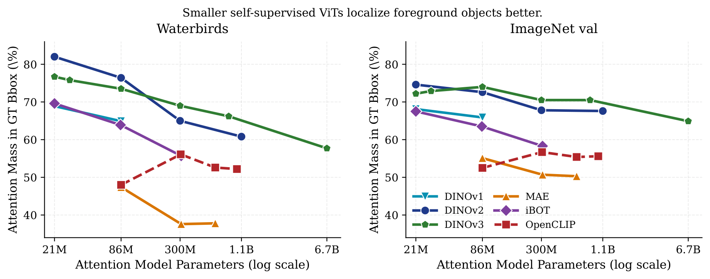

# A^2: Smaller Self-Supervised ViTs Localize Better than Larger Ones

```
@inproceedings{rammohan2026a,
  title={{$A^2$}: Smaller Self-Supervised ViTs Localize Better than Larger Ones},
  author={Sreehari Rammohan and Huy Ha and Carl Vondrick},
  booktitle={NeurIPS 2026},
  year={2026},
  url={https://arxiv.org/abs/2606.03148}
}
```



Share of last-layer attention inside the ground-truth box vs. model size (Figure 2). All five self-supervised families slope downward; OpenCLIP (dashed) does not.

## Install

```bash
python -m venv .venv && source .venv/bin/activate
pip install -r requirements.txt
```

Install Pillow from pip: its wheels use libjpeg-turbo, like the paper's runs (other JPEG builds decode slightly differently; `data.py` warns if so).

## Data

Download only what you need; the paths below are the ones used in the commands further down.

**Waterbirds** (2 classes, groups = bird type × background). The Hugging Face copy used for the paper:

```bash
hf download grodino/waterbirds --repo-type dataset \
    --revision e9856c710d0da2e4029d116cdd9d5fce7cc2bc80 --local-dir data/waterbirds
# data/waterbirds/data/test-00000-of-00001.parquet has SHA-256 fdb8696ce4db78c0ad48dd0120aaae40ce4330416d37fc41c9ea57faadc007f7
```

**Spawrious O2O Hard and M2M Hard** (4 dog breeds, groups = breed × background). The full dataset (16 GB) from the [official repository](https://github.com/aengusl/spawrious):

The download link for Spawrious was taken from this file: https://github.com/aengusl/spawrious/blob/main/spawrious/torch.py and is copied below. 

```bash
curl -L -o spawrious224.tar.gz 'https://www.dropbox.com/s/hofkueo8qvaqlp3/spawrious224__entire_dataset.tar.gz?dl=1'
mkdir -p data/spawrious && tar -xzf spawrious224.tar.gz -C data/spawrious      # -> data/spawrious/spawrious224/
```

**MetaShift Cat vs. Dog and MetaShift Animals** (GQA / Visual Genome images, 21.8 GB zip plus about 22 GB unpacked):

```bash
wget https://nlp.stanford.edu/data/gqa/images.zip && unzip images.zip -d data/gqa   # -> data/gqa/images/<id>.jpg
```

**MetaShift Animals** is the 8-class benchmark introduced in the paper; see the [MetaShift Animals repository](https://github.com/SreehariRamMohan/MetaShift_Animals) for details and a standalone loader.

**Localization only.** The Waterbirds download above plus the [CUB-200-2011](https://www.vision.caltech.edu/datasets/cub_200_2011/) annotations (`images.txt`, `bounding_boxes.txt`; the photos themselves are not needed), and the [ImageNet](https://image-net.org/challenges/LSVRC/2012/2012-downloads.php) validation images and boxes (`ILSVRC2012_img_val.tar`, `ILSVRC2012_bbox_val_v3.tgz`), each extracted into a flat folder of `ILSVRC2012_val_%08d.JPEG` / `.xml` files.

`manifests/` pins every benchmark row (images, labels, worst-group ids) to the paper's runs. This matters for Spawrious O2O Hard: its official loader takes the first N files of an unsorted directory listing, so which training images you get depends on your filesystem. The O2O manifest pins the exact images the paper trained on (about 14% of them differ from what a typical fresh copy would give). MetaShift Animals keeps images that belong to several contexts as separate rows, as in the paper.

## Weights

Everything downloads on first use from the official releases (into `$TORCH_HOME` / `$HF_HOME`). The one exception is **DINOv3**, which is gated: accept Meta's license on the model pages on Hugging Face and run `hf auth login`. `python models.py` lists all 30 models. To pre-fetch weights (e.g. for compute nodes without internet), pass model names or families: `python models.py --download dinov2` fetches just the four DINOv2 models, `--download all` fetches everything.

| Family | Models | Source |
|---|---|---|
| DINOv1 | `dinov1-vits16`, `dinov1-vitb16` (+ `/8` controls `dinov1-vits8`, `dinov1-vitb8`) | official checkpoints, `dl.fbaipublicfiles.com/dino` |
| DINOv2 (4 registers) | `dinov2-vits14`, `-vitb14`, `-vitl14`, `-vitg14` | `torch.hub` `facebookresearch/dinov2` (pinned commit) + official `_reg4` weights |
| DINOv3 (LVD-1689M) | `dinov3-vits16`, `-vits16plus`, `-vitb16`, `-vitl16`, `-vith16plus`, `-vit7b16` | Hugging Face `facebook/dinov3-*-pretrain-lvd1689m` (gated) |
| MAE | `mae-vitb16`, `mae-vitl16`, `mae-vith14` | timm `vit_*_224.mae` |
| iBOT | `ibot-vits16`, `-vitb16`, `-vitl16` | official teacher checkpoints (ByteDance) |
| OpenCLIP (LAION-2B) | `clip-vitb16`, `-vitl14`, `-vith14`, `-vitg14` | `open_clip` |
| OpenAI CLIP (control) | `clip-vitb16-oai`, `clip-vitl14-oai` | `open_clip`, `pretrained='openai'` |
| DeiT, DeiT-III (supervised controls) | `deit-s16`, `deit3-s16`, `deit3-b16`, `deit3-l16` | timm `*.fb_in1k` |

If you already have the weights downloaded, set `--weights DIR` to a folder containing the models with their official file name intact. See below for the structure.

```text
DIR/
├── dino_deitsmall16_pretrain.pth                # DINOv1: official file names
├── dino_vitbase16_pretrain.pth
├── dinov2_vits14_reg4_pretrain.pth              # DINOv2: official file names
├── dinov2_vitg14_reg4_pretrain.pth
├── vits_16_teacher.pth                          # iBOT: vit{s,b,l}_16_teacher.pth (upstream names them all checkpoint_teacher.pth)
├── vit_base_patch16_224.mae/model.safetensors   # MAE, DeiT, DeiT-III: timm model name / model.safetensors
├── deit_small_patch16_224.fb_in1k/model.safetensors
└── facebook_dinov3-vits16-pretrain-lvd1689m/    # DINOv3: Hugging Face snapshot, "/" in the repo id replaced by "_"
```

Models missing from `DIR` are downloaded as usual. OpenCLIP and OpenAI CLIP always load from the `open_clip` / Hugging Face cache.

## Figure 2: smaller self-supervised ViTs localize better

```bash
python localization.py --dataset waterbirds --data data/waterbirds --boxes data/CUB_200_2011 --models all
python localization.py --dataset imagenet --data data/imagenet/val --boxes data/imagenet/bboxes --models dinov2 mae
python localization.py --plot    # figures/fig2_mass.pdf, figures/fig2_hit.pdf (--controls adds the appendix models)
```

`--models` takes model names, family prefixes (`dinov2`, `mae`, ...) or `all`; `--limit N` runs a quick check on the first N images. Results go to `results/localization.csv`.

Protocol: images are resized to 224×224 (no center crop); the map is the last block's CLS-to-patch attention (CLS and register tokens dropped), averaged over heads and upsampled to 224×224 with nearest-neighbour interpolation; attention mass is the fraction inside the box (union of boxes on ImageNet) and a hit means the attention peak lies in it. No layer, head or threshold is tuned.

## A²: crop where a small ViT looks, embed with a large one

```bash
python a2.py --benchmark metashift-animals --data data/gqa/images             # ViT-S attention, ViT-G embedding
python a2.py --benchmark spawrious-o2o-hard --data data/spawrious \
    --attn dinov2-vits14 dinov2-vitb14 dinov2-vitl14 dinov2-vitg14                # where to look
python a2.py --benchmark waterbirds --data data/waterbirds --full-image         # full-image baseline
python a2.py --plot                                                             # figures/where_to_look.pdf
```

For each image, the attention model's map picks two non-overlapping square crops, 64×64 then 32×32 in the 224×224 frame, each covering the most attention. Each crop is resized to 224×224 and embedded by the embedding model; the two CLS embeddings are concatenated and a logistic regression is fit on the training split. We report test accuracy and worst-group accuracy (worst class for MetaShift Animals). Features are cached in `cache/`, so sweeps and refits are cheap.
